# tinygo-cyd コード解説

ESP32-4827S043（ESP32-S3 + 4.3インチ 480×272 RGB 液晶）を TinyGo で動かすためのコード一式の解説。
「どこに何があり、なぜそうなっているか」を、今後自分で直せることを目標に説明する。

- 図は Mermaid で書いている。GitHub や VS Code（Markdown Preview Mermaid Support 拡張）で図として表示される。
- リンクはリポジトリ内のファイル（行番号付きのものもある）。行番号は 2026-10 時点のもの。
- 理解度の確認は [QUIZ.md](QUIZ.md)、解答は [QUIZ_ANSWERS.md](QUIZ_ANSWERS.md)（どちらも手元だけに置き、git では管理しない）。

## 目次

1. [用語](#1-用語)
2. [全体像](#2-全体像)
3. [ビルドの切り替え（実機・ブラウザ・ホスト）](#3-ビルドの切り替え実機ブラウザホスト)
4. [液晶表示の仕組み（rgblcd）](#4-液晶表示の仕組みrgblcd)
5. [メモリの使い方](#5-メモリの使い方)
6. [描画 API とバックエンド](#6-描画-api-とバックエンド)
7. [ブラウザ版（wasmlcd）](#7-ブラウザ版wasmlcd)
8. [テスト](#8-テスト)
9. [タッチパネル](#9-タッチパネル)
10. [フラッシュとスライドショー（05）](#10-フラッシュとスライドショー05)
11. [SD カードのスライドショー（06）](#11-sd-カードのスライドショー06)
12. [ゲーム（07〜14）](#12-ゲーム0714)
13. [運用：コマンド・よくある作業・トラブル](#13-運用コマンドよくある作業トラブル)
14. [未解決・注意事項](#14-未解決注意事項)
15. [ESP32-3248S035C（3.5インチ・SPI 液晶）](#15-esp32-3248s035c35インチspi-液晶)
16. [ESP32-2432S028R（2.8インチ・320×240）](#16-esp32-2432s028r28インチ320240)
17. [PicoPad のゲームの移植（picopad、15）](#17-picopad-のゲームの移植picopad15)

---

## 1. 用語

| 用語 | 意味 |
|---|---|
| RGB565 | 1画素 16bit の色形式。上位から R 5bit・G 6bit・B 5bit。 |
| RGB565BE | RGB565 を「上位バイト → 下位バイト」の順にバイト列で並べたもの（ビッグエンディアン）。`DrawRGBBitmap8` と画像ファイルがこの形式。 |
| フレームバッファ | 画面全体の画素を入れたメモリ。ここでは `[]uint16`（RGB565、行優先、480×272）。 |
| PCLK | ピクセルクロック。1クロックで1画素を液晶に送る。ここでは 9MHz。 |
| HSYNC / VSYNC | 水平・垂直同期信号。行の始まり・フレームの始まりを液晶に知らせる。 |
| DE | Data Enable。「今送っているのは表示データ」という信号。 |
| ポーチ | 同期パルスの前後の空白期間（front porch / back porch）。 |
| LCD_CAM | ESP32-S3 の液晶・カメラ用ペリフェラル。RGB パラレル出力を作る。 |
| GDMA | ESP32-S3 の汎用 DMA。メモリから LCD_CAM へデータを流す。 |
| ディスクリプタ | DMA に「どのメモリを何バイト送るか、次はどれか」を教える 12 バイトの構造体。 |
| GPIO マトリクス / IO_MUX | ペリフェラルの信号を任意の GPIO ピンにつなぐ仕組み。 |
| DROM / IROM | フラッシュをキャッシュ経由でメモリとして見せるアドレス空間（データ用 0x3C000000〜 / 命令用 0x42000000〜）。 |
| MMU | 上の仮想アドレスとフラッシュの物理位置を対応付ける表。64KB ページ単位。 |
| hal | このリポジトリのアプリが依存するインターフェース（`hal.Display`、`hal.Touch`）。 |
| ゴールデン画像 | 「正しい画面」として保存した PNG。テストで描画結果とピクセル単位で比較する。 |

---

## 2. 全体像

### ディレクトリ

| ディレクトリ | 役割 | 動く場所 |
|---|---|---|
| [board/](../board/board.go) | ピン番号・タイミング・キャリブレーション値など**ボード固有の値をすべて**ここに置く | 全部 |
| [hal/](../hal/hal.go) | アプリが依存するインターフェース `Display`・`Touch` | 全部 |
| [framebuf/](../framebuf/framebuf.go) | RGB565 フレームバッファへの描画（点・矩形・ビットマップ） | 全部 |
| [rgblcd/](../rgblcd/) | **LCD_CAM + GDMA の液晶ドライバ**（このリポジトリの中心） | 実機（計算部分はホストでもテスト） |
| [wasmlcd/](../wasmlcd/wasmlcd.go) | ブラウザの canvas に表示・マウス/タッチを入力にする | ブラウザ |
| [memlcd/](../memlcd/memlcd.go) | メモリ上の表示（テスト用、PNG 出力） | ホスト |
| [platform/](../platform/) | ビルド先に応じて上の3つを選んで初期化 | 全部 |
| [xpttouch/](../xpttouch/) | XPT2046 タッチの読み取り | 実機 |
| [touchcal/](../touchcal/calib.go) | タッチの raw 値 → 画面座標、4隅からのキャリブレーション | 全部 |
| [romfont/](../romfont/romfont.go) | フォントを文字列にしてフラッシュに置く（tinyfont と同じ描画）。`go generate ./romfont` で [tools/fontgen](../tools/fontgen/main.go) が作る | 全部 |
| [spilcd/](../spilcd/spilcd.go) | SPI 液晶（ST7796・ILI9341）のドライバ。フレームバッファなし。DMA で裏で送れる（`DrawRGBBitmap8Async`） | 実機（ホストでもテスト） |
| [espdma/](../espdma/espdma.go) | ESP32 の SPI を DMA で送る（`machine.SPI` を包む） | 実機 |
| [board/s035/](../board/s035/s035.go)・[gt911/](../gt911/gt911.go)・[viewport/](../viewport/viewport.go) | ESP32-3248S035C 用（[15章](#15-esp32-3248s035c35インチspi-液晶)） | 実機（ドライバはホストでもテスト） |
| [board/s028/](../board/s028/s028.go) | ESP32-2432S028R 用（[16章](#16-esp32-2432s028r28インチ320240)） | 全部 |
| [internal/panelcheck/](../internal/panelcheck/panelcheck.go) | SPI 液晶基板の確認プログラム（s035_check・s028_check）の共通部分 | 実機 |
| [pad/](../pad/pad.go) | ゲームコントローラー（`hal.Pad`）：押した瞬間とスティックの繰り返し（`Input`）、向きに一番近いものへのフォーカス移動（`Move`）、ジョイスティックのボタンへの変換（`Joystick`） | 全部 |
| [minijoy/](../minijoy/minijoy.go) | I2C のミニジョイスティックモジュール（0x5A）のドライバ。ボタン名は基板の印字（A・B・X・Y、Arduino ライブラリの名前とは違う）。確認は [joystick_check](../examples/joystick_check/main.go)（README に実機での結果） | 実機（ホストでもテスト） |
| [flashmap/](../flashmap/flashmap.go) | フラッシュの任意の領域を MMU でメモリとして読めるようにする | 実機 |
| [slidepack/](../slidepack/slidepack.go) | 複数の全画面画像を1ファイルにまとめる形式 | 全部 |
| [slideshow/](../slideshow/) | スライドショー本体（切り替え効果・キャプション・タッチ操作）と SD 用の読み込み | 全部 |
| [app/](../app/app.go) | お絵描きアプリ（`cmd/app` の中身） | 全部 |
| [games/](../games/) | ゲーム本体（invaders・sudoku・othello・solitaire・poker・kart・starguard）とトランプの部品（cards）。hal だけに依存 | 全部 |
| [cmd/app/](../cmd/app/main.go) | 実機・ブラウザ共通のエントリポイント | 全部 |
| [cmd/games/](../cmd/games/main.go) | ゲームを選んで遊ぶランチャー | 全部 |
| [examples/](../examples/) | 01〜08 のサンプル | 例ごとに異なる |
| [internal/](../internal/) | テスト補助（goldentest）、C 用 malloc 補助（espmalloc） | — |
| [tools/](../tools/) | 画像変換（img2rgb565）、HTTP サーバ（serve）、ブラウザ検査（wasmcheck） | ホスト |
| [targets/](../targets/esp32-4827s043.json) | TinyGo のカスタムターゲット | — |
| [web/](../web/index.html) | ブラウザ版の HTML | ブラウザ |
| [testdata/golden/](../testdata/golden/) | ゴールデン画像 | ホスト |

### 依存関係

アプリ（`app`、`slideshow`、ゲーム）は `hal` にしか依存しない。だから同じコードが実機でもブラウザでもテストでも動く。

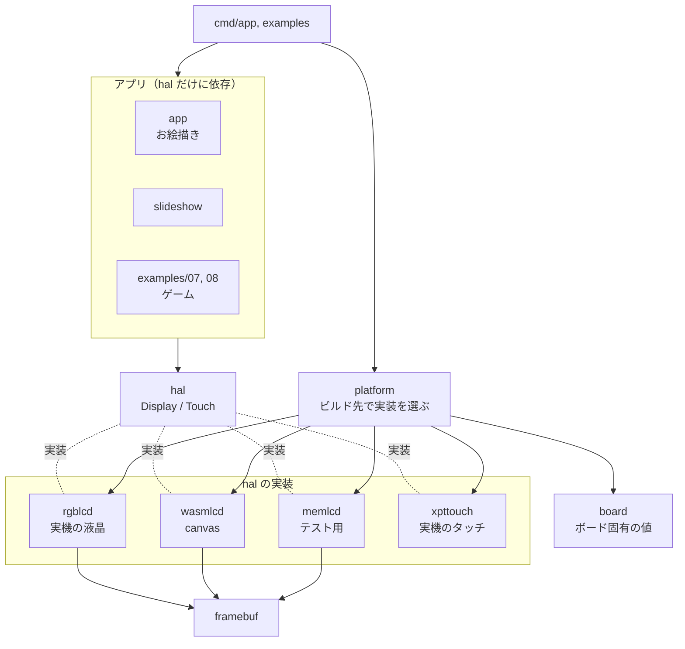

---

## 3. ビルドの切り替え（実機・ブラウザ・ホスト）

同じソースから3種類のプログラムを作る。どのファイルを使うかは **Go のビルドタグ**（ファイル先頭の `//go:build ...`）で決まる。

| ビルド | コマンド | 有効なタグ | `platform.Init()` の実体 |
|---|---|---|---|
| 実機 | `tinygo build -target=./targets/esp32-4827s043.json` | `esp32s3` ほか | [platform_esp32s3.go](../platform/platform_esp32s3.go)：rgblcd + xpttouch |
| ブラウザ | `tinygo build -target=wasm` | `js`, `wasm` | [platform_wasm.go](../platform/platform_wasm.go)：wasmlcd（表示とタッチを兼ねる） |
| ホスト | `go test` / `go run` | （なし） | [platform_other.go](../platform/platform_other.go)：memlcd + 押されないタッチ |

- `machine` パッケージ（GPIO など）を使うファイルは必ず `//go:build esp32s3` を付ける。付けないとホストの `go test ./...` が「package machine is not in std」で失敗する。
- `rgblcd` は「計算だけのファイル（タグなし）」と「レジスタを触るファイル（esp32s3）」に分かれている。計算部分（[calc.go](../rgblcd/calc.go)）はホストでテストできる。

### カスタムターゲット [targets/esp32-4827s043.json](../targets/esp32-4827s043.json)

```json
{
  "inherits": ["esp32s3-generic"],   // machine パッケージが SPI のピン定数を要求するため generic を継承
  "build-tags": ["esp32_4827s043"],
  "serial": "uart",                  // USB-C は CH340C 経由で UART0 につながっている
  "flash-method": "esp32flash",      // UART 経由の書き込み
  "ldflags": ["--defsym=Cache_Invalidate_Addr=0x400016b0", ...]  // flashmap が使う ROM 関数の番地
}
```

---

## 4. 液晶表示の仕組み（rgblcd）

### 4.1 データの流れ

**CPU は画面を「送らない」**。フレームバッファに書くだけで、あとは GDMA と LCD_CAM が毎秒約57回、勝手に液晶へ送り続ける。

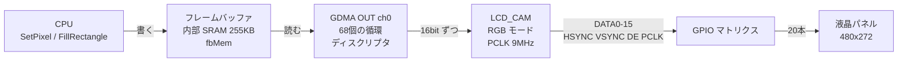

- フレームバッファの1画素（`uint16`）の bit0〜15 が、そのまま LCD_CAM の `DATA_OUT0〜15` に出る。
- [board.DataPins()](../board/board.go) が `DATA_OUT0〜4 = B0〜B4`、`5〜10 = G0〜G5`、`11〜15 = R0〜R4` の順にピンを並べる。これで普通の RGB565（上位 5bit が赤）がそのまま正しい色になる。

### 4.2 パネルの信号タイミング

1行 = 4（HSYNC）+ 43（バックポーチ）+ 480（表示）+ 8（フロントポーチ）= **535 PCLK**。
1フレーム = 4 + 12 + 272 + 8 = **296 行**。9MHz ÷ (535 × 296) ≒ **56.83 fps**。

```
1行（PCLK 単位）
HSYNC  ‾‾‾‾|____|‾‾‾‾‾‾‾‾‾‾‾‾‾‾‾‾‾‾‾‾‾‾‾‾‾‾‾‾‾‾‾‾‾‾‾‾‾‾‾‾‾‾‾‾‾‾‾‾‾‾‾‾‾‾‾‾|____|‾‾  ← ※実際の極性は下表
            4      43           480（DE=1、データ）          8
DE     ________________________|‾‾‾‾‾‾‾‾‾‾‾‾‾‾‾‾‾‾‾‾‾‾‾‾‾‾‾‾‾|_______________
           パルス  バックポーチ           表示            フロントポーチ
```

| 設定（[board.go](../board/board.go)） | 値 | 意味 |
|---|---|---|
| `PclkHz` | 9_000_000 | 不安定なら 8MHz → 7MHz に下げる |
| `HSyncIdleLow` / `VSyncIdleLow` | true | 待機時 Low（Arduino_GFX の polarity 0） |
| `PclkActiveNeg` | true | PCLK の立ち下がりでデータを出す |
| `DEIdleHigh` | false | 待機時 DE は Low |

### 4.3 クロックの計算（[CalcClock](../rgblcd/calc.go#L27)）

ESP-IDF の `lcd_hal_cal_pclk_freq` をそのまま移植したもの。

```
lcd_clk   = ソース ÷ (N + B/A)
pixel_clk = lcd_clk ÷ MO
```

9MHz の場合：ソース PLL_F160M = 160MHz。`PclkActiveNeg` があると `MO = 1` は使えない（極性を変えられないため）ので MO = 2。
160 ÷ 18 = 8 余り 16 → **N=8、A=9、B=8、MO=2**。lcd_clk = 18MHz、pclk = 9MHz ちょうど。
実機のレジスタ値 `LCD_CLOCK=e4901101` はこの値を含む。

### 4.4 タイミングレジスタ（[CalcTiming](../rgblcd/calc.go#L109)）

ESP-IDF `lcd_ll_set_horizontal_timing` / `lcd_ll_set_vertical_timing` の変換式（レジスタには「値 − 1」を書く）。

| フィールド | 式 | 値 |
|---|---|---|
| `LCD_HSYNC_WIDTH` | hsw − 1 | 3 |
| `LCD_HB_FRONT` | hbp + hsw − 1 | 46 |
| `LCD_HA_WIDTH` | 幅 − 1 | 479 |
| `LCD_HT_WIDTH` | hsw + hbp + 幅 + hfp − 1 | 534 |
| `LCD_VSYNC_WIDTH` | vsw − 1 | 3 |
| `LCD_VB_FRONT` | vbp + vsw − 1 | 15 |
| `LCD_VA_HEIGHT` | 高さ − 1 | 271 |
| `LCD_VT_HEIGHT` | vsw + vbp + 高さ + vfp − 1 | 295 |

各フィールドにはビット幅の上限があり（例：`VT_HEIGHT` は 10bit = 1023 まで）、超えると `ErrBadTiming`。

### 4.5 DMA ディスクリプタ（[gdma.go](../rgblcd/gdma.go)、[DescLayout](../rgblcd/calc.go#L173)）

1つのディスクリプタで送れるのは最大 4095 バイト。1行 = 960 バイトなので、**4行（3840 バイト）× 68 個**に分ける。最後のディスクリプタの `next` を先頭に向けて**輪**にする。

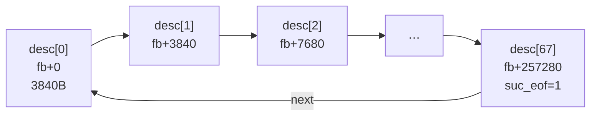

- ディスクリプタのワード0：`size`（bit0-11）、`length`（bit12-23）、`suc_eof`（bit30）、`owner`（bit31 = DMA）。[DescWord0](../rgblcd/calc.go#L158) が作る。
- `descs` は**パッケージのグローバル変数**。DMA が動いている間に GC で回収されないこと、内部 SRAM にあることが必要なため（`OUTLINK_ADDR` はアドレスの下位 20bit しか持たない）。
- オーナーチェック（`OUT_CHECK_OWNER`）を切っているので、DMA が一周してもディスクリプタを書き戻す必要がない。
- LCD_CAM の `LCD_NEXT_FRAME_EN` を立てているので、1フレーム送り終わると LCD_CAM が自分で次のフレームを要求する。**CPU の介入なしで表示が続く**のはこの2つの組み合わせのため。

### 4.6 GPIO マトリクス（[gpio.go](../rgblcd/gpio.go)）

20本のピンそれぞれに「LCD_CAM のどの信号を出すか」を書く。信号番号は ESP-IDF `gpio_sig_map.h` から。

| 信号 | 番号 | GPIO |
|---|---|---|
| LCD_DATA_OUT0〜15 | 133〜148 | B0-4: 8,3,46,9,1 / G0-5: 5,6,7,15,16,4 / R0-4: 45,48,47,21,14 |
| LCD_H_ENABLE（DE） | 150 | 40 |
| LCD_H_SYNC | 151 | 39 |
| LCD_V_SYNC | 152 | 41 |
| LCD_PCLK | 154 | 42 |

`routePin` は「IO_MUX の機能を GPIO（MCU_SEL=1）に → `FUNCn_OUT_SEL_CFG` に信号番号 → 出力を有効化」の順。

### 4.7 初期化の順序（[New](../rgblcd/display.go#L46)・[Start](../rgblcd/display.go#L109)）

ESP-IDF の `esp_lcd_new_rgb_panel` → `esp_lcd_panel_reset` → `esp_lcd_panel_init` → `lcd_rgb_panel_start_transmission` と同じ順序。

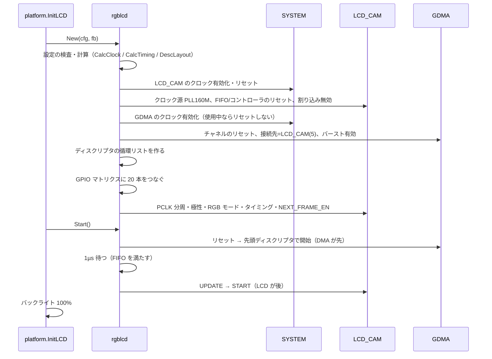

### 4.8 デバッグ用の仕組み

- [Dump()](../rgblcd/display.go#L172)：設定した全レジスタを**読み戻し**、計算した期待値と比べて `OK/NG` を表示する。最後に `=== register check: OK ===`。
- [SelfTest()](../rgblcd/clock.go#L65)：LCD_CAM と GDMA のレジスタに値を書いて読み戻せるかを試す（フェーズ1）。
- [examples/02_colorbars](../examples/02_colorbars/main.go)：上の2つを順に実行し、カラーバーを出す。シリアルで `c r g b w k d` を受け付ける。tick 行に `regs OK`、`fps`、DMA が今どのディスクリプタを読んでいるか（`desc:`）を出す。

### 4.9 ティアリング対策（[WaitVSync](../rgblcd/display.go#L150)）

LCD_CAM はフレームを送り終わるたびに `LC_DMA_INT_RAW` の bit0（VSYNC）を立てる。`WaitVSync` はこのビットを消して、また立つまで**ポーリング**で待つ。割り込みハンドラは使っていない。
`Display()` は何もしない（常に表示されているため）。ゲームは毎フレーム `WaitVSync` の直後に描くことで、描きかけの画面が映りにくくしている。

---

## 5. メモリの使い方

ESP32-S3 の内部 SRAM のうち、TinyGo が使えるのは `0x3FC88000〜0x3FCEB710`（約 398KB、上は ROM と Wi-Fi が使う）。この領域は IRAM（命令）と共有。

```
0x3FC88000 ┌────────────────────────┐
           │ スタック 4KB            │
0x3FC89000 ├────────────────────────┤
           │ .bss                   │ ← descs（1.5KB）と fbMem（255KB）はここ
           │   descs  0x3FC890E4〜   │
           │   fbMem  0x3FC896E4〜   │
           ├────────────────────────┤
           │ .data（フォント等 ~10KB）│
           ├────────────────────────┤
           │ IRAM の影（~2.4KB）      │ ← mapPages など IRAM に置いたコード
           ├────────────────────────┤
           │ ヒープ 約 123KB          │ ← make / new / goroutine のスタック
0x3FCEB710 └────────────────────────┘
```

- **フレームバッファはグローバル配列** [`fbMem`](../platform/platform_esp32s3.go#L17)。`[480*272/2]uint32` と宣言しているのは **4 バイト境界に揃えるため**（`uint16` の配列だと 2 バイト境界の可能性がある）。`rgblcd.New` は境界と「DMA が読める範囲（0x3FC88000〜0x3FD00000）にあるか」を検査する。
- PSRAM（8MB）は使っていない。TinyGo の PSRAM 対応が不明なため。
- Wi-Fi（espradio）を足すとヒープが足りなくなる可能性が高い。

---

## 6. 描画 API とバックエンド

### hal.Display と framebuf

[hal.Display](../hal/hal.go) は tinygo drivers の `Displayer`（`Size`、`SetPixel`、`Display`）に `FillRectangle` を足したもの。tinydraw・tinyfont は `Displayer` しか使わないので、そのまま動く。

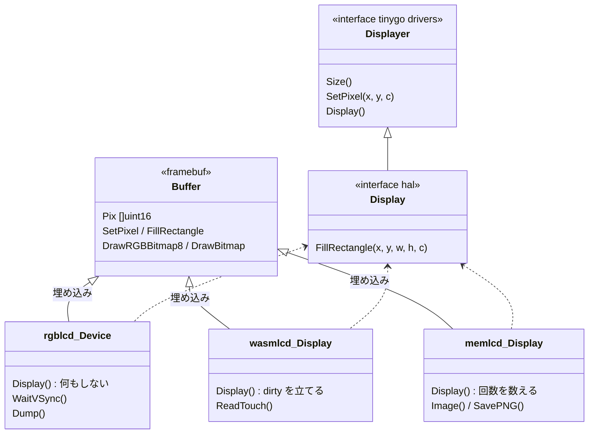

- 3つのバックエンドは**同じ形式のフレームバッファ**（`[]uint16`、RGB565、行優先）を `framebuf.Buffer` として埋め込んでいる。違うのは「バッファがどう画面に届くか」だけ。
- `FillRectangle` は1行目を埋めてから `copy` で下の行に複製する（ループより速い）。
- `DrawRGBBitmap8` は **RGB565BE のバイト列**を受け取る。画像ファイル（.rgb565、slidepack）とゲームのスプライト描画がこれを使う。

---

## 7. ブラウザ版（wasmlcd）

[wasmlcd.go](../wasmlcd/wasmlcd.go) は canvas に描く。

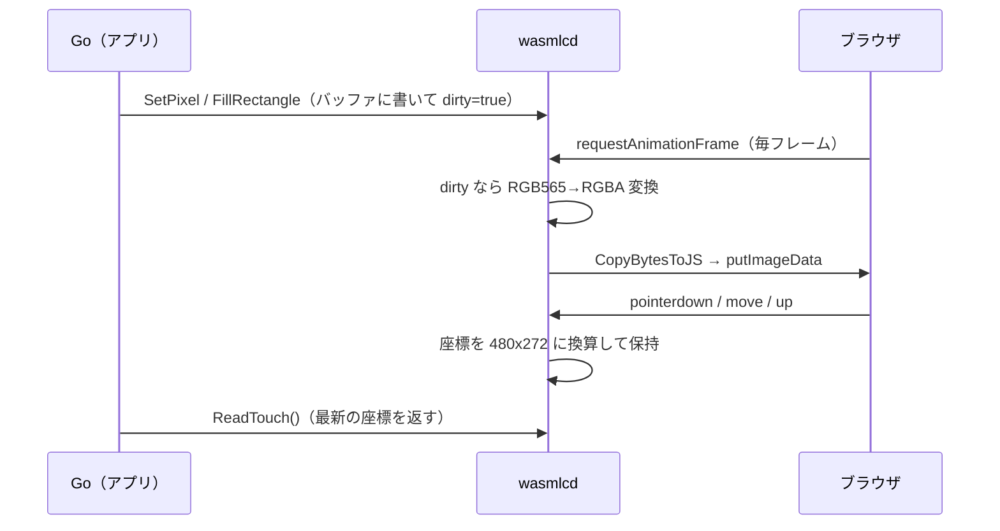

- `wasm_exec.js` は **TinyGo 付属のもの**を使う（Go 付属のものは互換性がない）。`make wasm` が毎回コピーする。
- `.wasm` は `application/wasm` の MIME で配信する必要があり、`file://` では動かない。`make serve`（[tools/serve](../tools/serve/main.go)）がそうする。
- `main` から return するとプログラムが終わるので、ループで回し続ける。
- headless Chromium での検査用に、`window.wasmlcdFlush_lcd()` で即座に canvas へ転送できる。headless の仮想時間モードでは requestAnimationFrame が来ないため。

---

## 8. テスト

| 種類 | 場所 | 何を確かめるか |
|---|---|---|
| 計算 | [rgblcd/calc_test.go](../rgblcd/calc_test.go) | PCLK 分周・タイミング値・ディスクリプタを、ESP-IDF の式から手計算した値と比較 |
| ゴールデン画像 | [app](../app/app_test.go)、[05](../examples/05_slideshow/main_test.go)、[07](../examples/07_breakout/game_test.go)、[08](../games/invaders/game_test.go) | memlcd で描いた画面を `testdata/golden/*.png` とピクセル単位で比較 |
| ロジック | 各 `_test.go` | タッチ操作、スライドの切り替え、ゲームの自動プレイ、BMP 変換など |
| ブラウザ | [tools/wasmcheck](../tools/wasmcheck/wasmcheck_test.go) | headless Chromium で canvas を読み、同じゴールデン画像と比較 |

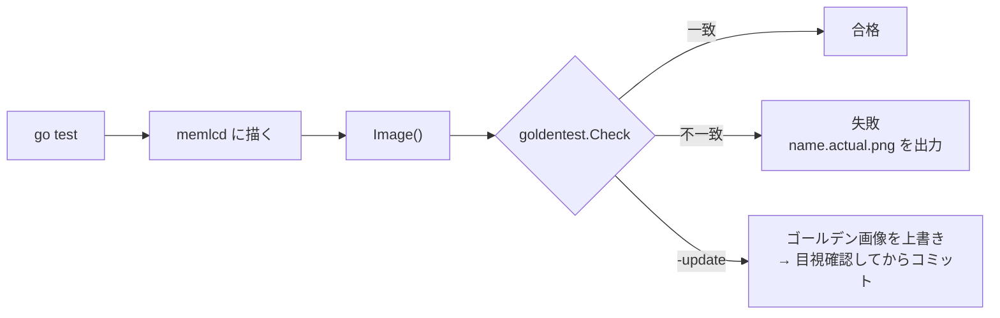

- 画面を意図して変えたら `make update-golden` で更新し、**画像を目で見てから**コミットする。
- 実機でしか確かめられないもの：レジスタ設定、RAM 容量、描画速度、ティアリング、液晶の発色、タッチの精度、SD カード、Wi-Fi。

---

## 9. タッチパネル

- XPT2046（抵抗膜）。tinygo drivers の [xpt2046](https://github.com/tinygo-org/drivers/tree/release/xpt2046) を使う。このドライバは **SPI を GPIO で1ビットずつ操作（ビットバング）** しており、読み取りに時間がかかる。
- ピン：SCK=12、MOSI=11、MISO=13、CS=38、INT=18（押されると Low）。SCK/MOSI/MISO は microSD と共有。
- [xpttouch.ReadRaw](../xpttouch/xpttouch.go#L30)：ドライバが返す 16bit 値を 12bit に戻す。[Calibration.Map](../touchcal/calib.go#L18)：raw 値を画面座標に線形変換し、画面内に収める。
- キャリブレーション値は [board.go](../board/board.go) の `TouchRaw*`（実測：X 172〜3940、Y 3884〜329、軸の入れ替えなし）。測り直しは [04_touch](../examples/04_touch/main.go)。
- [FromCorners](../touchcal/calib.go)：4隅のタップから値を求める。軸の入れ替わりを検出し、範囲が狭すぎる・同じ辺の2点が食い違う・向きが逆、のときは失敗にする。

---

## 10. フラッシュとスライドショー（05）

### 10.1 なぜ画像をプログラムに埋め込まないのか

TinyGo の ESP32-S3 は **ESP-IDF の2段目ブートローダを使わず、ROM が直接プログラムを読み込む**。ROM は約 1MB の rodata セグメントを「Invalid image block, can't boot」と拒否した。
そこで、画像は**プログラムとは別にフラッシュの 8MB 位置に書き**、実行時に MMU でメモリとして見えるようにして読む。

### 10.2 フラッシュの配置（16MB）

```
0x000000 ┌──────────────────────────┐
         │ プログラム（数十〜数百KB）  │ ← make flash / make flash-noerase
         │                          │
0x800000 ├──────────────────────────┤ ← board.SlidesFlashOffset
         │ slides.pack（1枚 255KB）   │ ← make flash-slides
         │                          │
0xFFFFFF └──────────────────────────┘
```

| コマンド | 何をするか | スライドは |
|---|---|---|
| `make flash` | `tinygo flash`。**フラッシュ全体を消去**してからプログラムを書く | **消える** |
| `make flash-noerase` | `tinygo build` で .bin を作り、espflasher で 0 番地に書く | 残る |
| `make flash-slides` | espflasher で `slides.pack` を 0x800000 に書く（`-fs 16MB` が必要） | 書かれる |

`-fs 16MB` がないと、espflasher（の書き込み用スタブ）は 4MB までしか書かせず、エラー 0xC4 になる。フラッシュサイズの自動検出はプログラムのイメージ（先頭 0xE9）でしか行われないため。

### 10.3 MMU マッピング（[flashmap.Map](../flashmap/flashmap.go#L70)）

ESP-IDF の `esp_mmu_map` と同じ手順。データキャッシュを止めている間はフラッシュを読めないので、その間に動くコード（[mapPages](../flashmap/flashmap.go#L92)）は `//go:section .iram1...` で **IRAM に置く**。

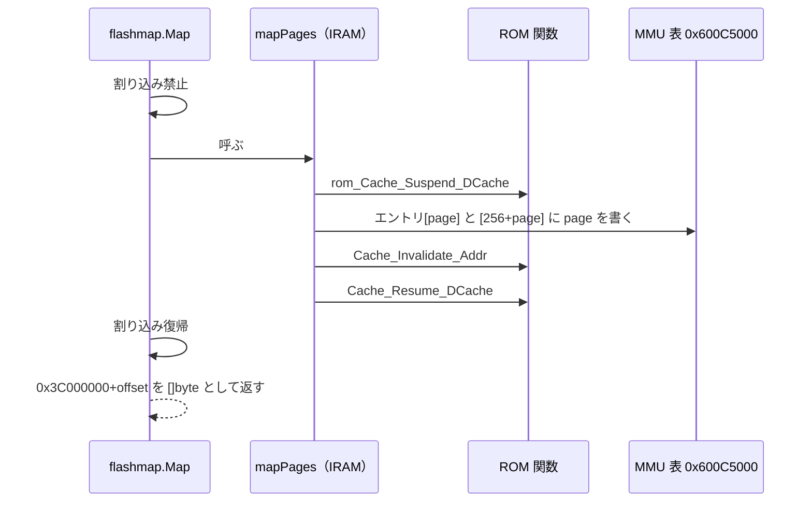

- ROM 関数の番地は TinyGo のリンカスクリプトにないので、ターゲットの `ldflags` に `--defsym` で書いている。
- エントリを2か所に書いているのは、ESP-IDF の解釈と TinyGo の起動コードの解釈が違い、どちらが正しいか決められなかったため（[14章](#14-未解決注意事項)）。

### 10.4 slidepack 形式（[slidepack.go](../slidepack/slidepack.go)）

```
0x0000  "SLD1"  幅(u16) 高さ(u16) 枚数(u32) 画像の開始位置(u32=4096) 1枚のサイズ(u32)
0x0014  名前 32 バイト × 枚数
0x1000  画像0（RGB565BE、480×272×2 = 261,120 バイト）
        画像1 …
```

作り方：`make slides`（= `go generate` → [tools/img2rgb565](../tools/img2rgb565/main.go) `-pack`）。変換は CatmullRom で縮小、`cover`（切り抜き）/`contain`（黒帯）、Floyd–Steinberg ディザリング。

05 は読み込み元をビルドタグで切り替える：実機は [source_flash.go](../examples/05_slideshow/source_flash.go)（flashmap）、ブラウザ・ホストは [source_embed.go](../examples/05_slideshow/source_embed.go)（`go:embed`）。

### 10.5 slideshow パッケージ

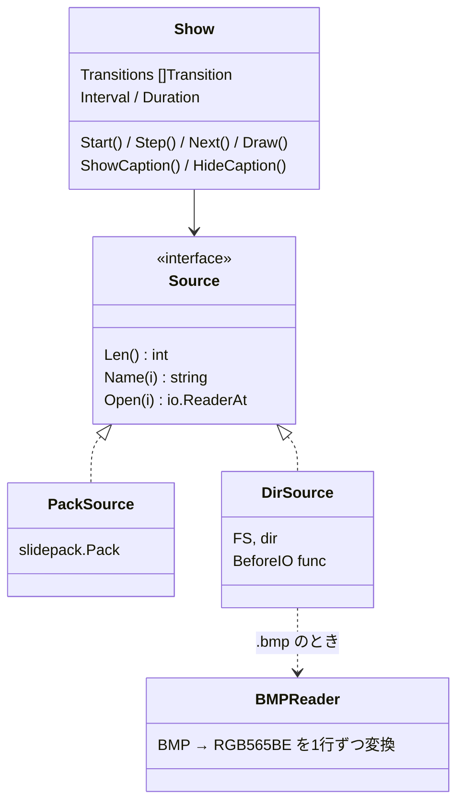

- 画像は**全部をメモリに読まない**。`ReadAt` で 8 行ずつ（15KB）読んで `DrawRGBBitmap8` で描く。
- 切り替え効果：Cut（一度に）、WipeDown（8行ずつ上から）、WipeRight（40列ずつ左から）、Blinds（8本の帯を1行ずつ）。
- キャプションは2秒後、**その部分の画像をもう一度読み直して**消す（`HideCaption`）。そのため `Source.Open` が返したリーダーは、次の `Open` まで有効である必要がある。
- タッチは**押し始めた瞬間**だけ反応する（`newPress`）。押し続けても繰り返さない。

---

## 11. SD カードのスライドショー（06）

- SD カード：CS=10、SCK/MOSI/MISO はタッチと共有。**FAT32、MBR** のみ（exFAT・GPT は tinyfs の FatFs 設定で無効）。
- 読める画像：480×272 の `.bmp`（24/32bit、無圧縮）と `.rgb565`。JPEG/PNG は RAM 不足で実機では展開しない。
- 名前が `.` で始まるファイル（macOS の `._xxx`）は無視。

### 共有 SPI バス（[bus.go](../examples/06_sdslideshow/bus.go)）

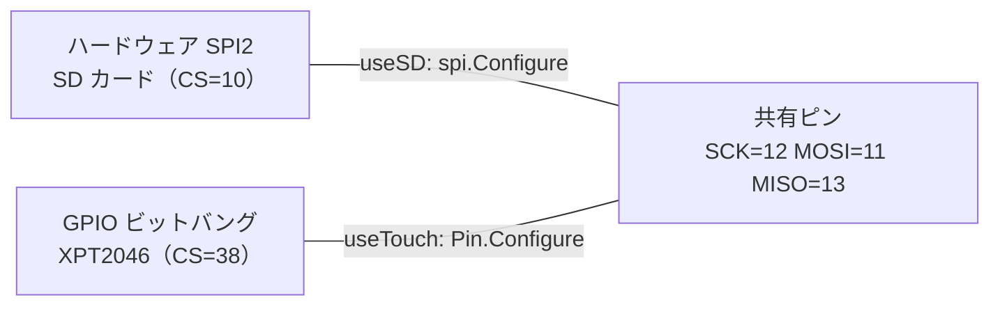

- SD を読む直前（`DirSource.BeforeIO`）に `useSD`：ピンを SPI に戻し、タッチの CS を High。
- タッチを読む直前（`busTouch.ReadTouch`）に `useTouch`：ピンを GPIO に戻し、SD の CS を High。
- 今どちらか（`mode`）を覚えているので、切り替えは必要なときだけ。

### C の malloc（[internal/espmalloc](../internal/espmalloc/espmalloc.go)）

tinyfs の fatfs は C コードで `malloc` を呼ぶ。ESP32-S3 のターゲットは `--wrap=malloc` でリンクするので、`malloc` の呼び出しは `__wrap_malloc` に向かう。普通は Wi-Fi ドライバ（espradio）が用意するが、使っていないと未定義になる。espmalloc は `__wrap_malloc` → `__real_malloc`（TinyGo のランタイムの malloc）と転送するだけ。**espradio と一緒に使うとシンボルが重複する。**

---

## 12. ゲーム（07〜14）

### ゲームループ（[07 main.go](../examples/07_breakout/main.go)、[08 main.go](../examples/08_invaders/main.go)）

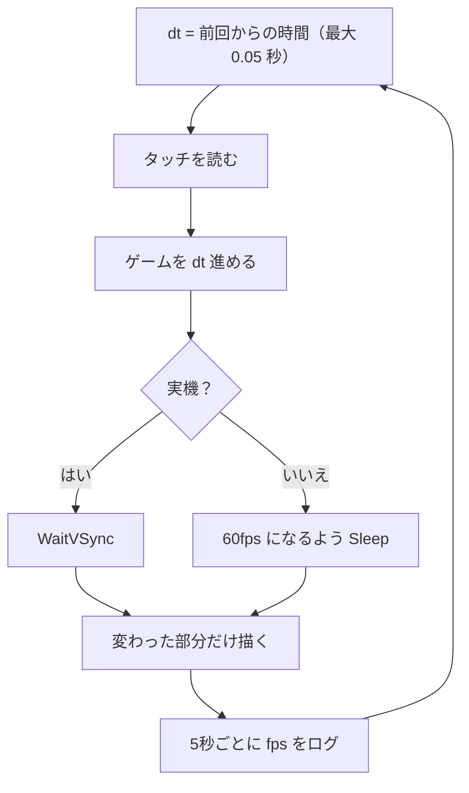

### 差分描画

毎フレーム全画面（261KB）を描き直さず、変わった所だけ描く。

| 対象 | 方法 |
|---|---|
| 07 パドル | 動いた分の「はみ出た部分」だけ背景色で消し、新しい位置に描く（消してから描くとちらつく） |
| 07 ボール・弾 | 古い位置を背景色で消し、新しい位置に描く（小さいので問題にならない） |
| 08 スプライト | 古い位置と新しい位置を合わせた矩形を**1枚の画像として作り**、`DrawRGBBitmap8` で1回で描く（`blit`） |
| 消えたブロック・敵 | その矩形だけ背景色にする |
| スコア | 変わったときだけ上の帯を描き直す |

### 07 ブロック崩し（[game.go](../examples/07_breakout/game.go)）

- ボールは1回に**最大 2px** ずつ、**横と縦を別々に**動かす。ブロックに重なったら、その軸だけ位置を戻して速度の符号を反転する。速くなってもすり抜けない。
- パドルに当たった位置で角度が決まる（中央 = 真上、端 = 60°）。
- 速さ：220 px/s × (1 + 0.1 × (レベル − 1))。

### 09 数独（[sudoku.go](../games/sudoku/sudoku.go)、[game.go](../games/sudoku/game.go)）

- 盤面は「乱数で完成した盤を作る → ランダムな順にマスを空ける → 解が2つ以上になるマスは戻す」で作るので、**解は必ず1つ**。間違いの判定は解と比べるだけでよい。
- 解を数える探索は再帰を使わず、配列のスタックで書いている（実機のスタックを使い切らないため）。候補が最も少ないマスから試す。
- 描画は、マスごとの「見た目」（背景色・文字色・数字）を覚えておき、変わったマスだけ描き直す。
- 元にした Arduino スケッチ（Sparkadium/Sudoku-for-CYD）は GPL-3.0 のため、コードは移さず、遊び方だけを参考にして書いた。

### 10 オセロ（[othello.go](../games/othello/othello.go)、[game.go](../games/othello/game.go)）

- 盤面は 64bit 整数2つ（手番側と相手側）。合法手は「8方向にシフトして、相手の石の並びの先が空いている所」をビット演算でまとめて求める。正しさは perft（初期局面から n 手先までの局面数の既知の値）で確かめている。
- CPU はαβ探索（negamax）。評価は「マスの価値（隅が高く、隅の隣は低い）」＋「打てる手の数の差」。1手、2手…と深くしていき（反復深化）、**調べた局面数の上限**を超えたら直前の深さの結果を使う。時間ではなく局面数で打ち切るのは、テストで同じ結果を再現するため。
- 探索中はヒープを使わない（手の並べ替えは呼び出し側のスタック上の配列に書く）。
- 手番の進行は状態の切り替え（あなたの番 → 裏返しアニメーション → CPU の思考 → …、パス、終局）。CPU が考える前の更新で「THINKING...」を描いておく。

### 11 ソリティア（[solitaire.go](../games/solitaire/solitaire.go)、[game.go](../games/solitaire/game.go)、[cards](../games/cards/cards.go)）

- トランプの部品（カードの型、切り混ぜ、表・裏・空き枠の描画、スートの 7×7 ドット絵）は `games/cards` にあり、ほかのカードゲームでも使える。
- 操作は「タップしたカードを置ける場所へ自動で動かす」だけ（ドラッグは抵抗膜タッチでは使いにくいため）。行き先は `AutoDest` が決める（1枚なら組札を優先、キングは意味のない空き列への移動をしない）。
- UNDO は状態を約80バイトのバイト列に詰めて最大200手まで保存する（スライスの深いコピーより省メモリ）。
- 描き直しは領域（山札・めくった札・組札・各列）ごとに「中身を表すキー」を覚えておき、変わった領域だけ。しかも盤面が変わったフレームだけ比較する（毎フレームキーを作るとGCの負担になる）。
- 長い列は重なり幅を詰めて画面に収め、詰めすぎて大きな角の文字が隠れるときは小さい角（`DrawFaceSmall`）で描く。

### 12 ビデオポーカー（[poker.go](../games/poker/poker.go)、[game.go](../games/poker/game.go)）

- ルールは「ジャックス・オア・ベター」、配当は 9/6（フルハウス 9・フラッシュ 6）。5枚賭けのロイヤルフラッシュだけ 1枚あたり 800（4000）になるのは実機のマシンと同じ。
- 役の判定（`Evaluate`）はランクごとの枚数を数え、「同じランクが2・3・4枚ある組の数」「全部同じスート」「5つ連続（A は 1 としても 14 としても使える）」から決める。正しさは 5枚の組み合わせ全 2,598,960 通りを数えて、各役の既知の数と一致することで確かめている。
- 1回の勝負（`Round`）は切り混ぜた山を持ち、DRAW では HELD でないカードを山の続きから配る。
- 状態は「待ち → 配る（1枚ずつめくれる）→ 選ぶ → 引く（1枚ずつめくれる）→ 待ち」。めくっている間のタップは無視する。選んでいる間は今できている役の行を水色、引いたあとは勝った役の行を黄色で光らせる。
- 描き直しはソリティアと同じ「領域ごとのキー」方式。

### 08 インベーダー（[game.go](../games/invaders/game.go)）

- 元祖と同じく、**1フレームに1体ずつ**動かす（[stepInvader](../games/invaders/game.go#L659)）。全員が1歩動くのに「生きている数」フレームかかるので、数が減るほど速くなる。
- 1周（全員が1歩）の間に誰かが端に着いたら、次の1周は全員が下に 8px 移動し、向きが反転する。
- 弾は 4px ずつ動かして当たり判定（すり抜け防止）。爆弾は同時に3発まで、乱数（xorshift、テストでは固定シード）で落とす。
- トーチカは 4×4px のセルの集まりで、当たったセルだけ消える。

---

### 13 カート（[games/kart](../games/kart/game.go)）

- **地面の描き方**（[render.go](../games/kart/render.go)）：カメラはカートの後ろ 28・高さ 32（ワールド座標）。地平線より下の各行 y は、カメラから `dist = 高さ × focal / (y − 地平線 + 1)` 先の、コースの地図を横切る1本の線。行の左端の地図上の位置と1画素ごとの増分を浮動小数点で1回求め、行の中は 16.16 の固定小数点の足し算と地図の表引きだけ（`groundRow`）。遠い行（`dist` > 120）は横半分の細かさで計算して2画素ずつ書き、もっと遠い行（> 300）は市松模様をやめる（ちらつくだけなので）。
- **地図**（[track.go](../games/kart/track.go)）：128×128 マス、1マス 8 ワールド単位。コースの中心線は 13 個の点を Catmull-Rom スプラインでつないで約1マスごとに取り、縁石・道路・スタートライン・加速パネルを塗る。各マスには「種類×2＋市松の色」を入れておき、描くときはパレットを引くだけ。作るのは `NewGame` の中（パッケージの初期化でスライスを作ると ESP32 で起動しなくなる、15章）。
- **カート**：CPU のカートは中心線に沿って位置 `s`（中心線の点の番号）を進め、自分の車線を走る。先の曲がり具合（`curve`）で減速し、プレイヤーよりずっと後ろなら少し速くなる。画面にはカメラからの距離で縮めた絵を、遠いものから地面の行に重ねて描く（`scaledRow`）。プレイヤーのカートはいつも下の真ん中で、曲がるときは運転手が傾く。
- **周回と順位**：プレイヤーは一番近い中心線の点（前回の点の前後 12 点から探す）を追い、スタートラインを前向きに越えたら1周。ただし半周の印を通ってから（逆走して越え直してもならない）。順位は「周回 × 点の数 ＋ 点」の大きさで比べる（CPU は `s` そのもの）。
- **速さ**：ESP32-2432S028R で 46 fps（1フレーム約 21ms のほとんどが地面の計算。送信は DMA で計算と重なる）。HUD（空の部分の周回・順位・タイム）は文字が変わったときだけ、その部分の空を描き直してから書く。小さな地図の点は、前の場所を地図の絵で塗り直してから描く。

### 14 スターガード（[games/starguard](../games/starguard/game.go)）

- **3D の描き方**（[world.go](../games/starguard/world.go)、[render.go](../games/starguard/render.go)）：船（カメラ）は原点で +z を向く。点 (x, y, z) は画面の (中央 + x×focal/z, 視界の中央 + y×focal/z) に、半径 r は r×focal/z の大きさで描く（`project`）。星は手前に流れ、近いほど明るく大きい点。敵・爆発・母艦は奥から順に並べ（`shown`）、スプライトを縮めて重ねる（カートと同じ `scaledRow`）。
- **敵の飛び方**：まっすぐ前から来ると、近づくにつれ画面の外へ出て、見えないまま当たる。そこで遠くの (x0, y0) から船のすぐ横 (tx, ty) へ、奥行きに比例して寄せる。画面の上ではほぼ出た場所にいて、最後に中央へ来る。ロボットは奥行きに比例した幅で左右に揺れる（画面の上で同じ幅に見える）。z が 40 を切ったら当たり（岩 10、ロボット・ドローン 15、それぞれ強さの倍率）。
- **撃つ**：弾は飛ばさず、撃った瞬間に照準の下で一番近い敵に当たる（`target`）。遠くて小さい敵も半径 4px までは当たる。母艦は横長なので、横に 1.4 倍の楕円で判定する。
- **ステージ**：決まった数（10・14・18）を倒すとクリアで、点とシールド +20。後のステージほど敵が多く・速く・ロボットが増える。母艦は奥から近づいて止まり、左右に揺れながらドローンを出す。HP（強さで 16・24・32）が尽きると、しばらく爆発を出し続けてから消え、残りのシールド ×5 が点に加わる。シールドが 70 未満のときはカプセルも飛んでくる。
- **描画**：視界（320×240 では上の 176 行）を8行ずつ、カートと同じ2つのバッファで、片方を DMA で送りながらもう片方に描く。下の計器はシールド・スコア・ステージが変わったときだけ描き、レーダーは毎フレーム小さな画像にして1回で送る。ESP32-2432S028R で 37 fps（視界の送信が律速）。

### ランチャー（[cmd/games](../cmd/games/launcher.go)）

- ゲームは `games/` のパッケージ。各ゲームの `OnExit` に関数を入れると、ゲームの最初の画面に「< GAMES」ボタンが出て、押すとその関数が呼ばれる（examples から単体で動かすときは `nil` なので出ない）。
- ランチャーは選ばれたゲームを作り、毎フレーム `Update(dt)` を呼ぶだけ。`OnExit` が呼ばれたらゲームを捨てて（GC が回収）、選ぶ画面を描き直す。
- **タップの持ち越しを防ぐ**：タイルをタップした指はまだ触れているので、そのままゲームに渡すとゲームの最初の画面でもタップとして扱われる（数独なら難易度ボタンが押される）。ゲームを始めた直後と戻った直後は、指が離れるまで入力を渡さない（`waitRelease`）。テストはタイルの「ゲームのボタンと重なる位置」（数独は重なるボタンがないので除く）をタップして、これを確かめている。
- タイルは 480×272 では 4列×2段、320×240 では 3列×3段（説明の行は入らないので省く）。タイルの名前は大きい文字で約 104px まで（「STAR GUARD」は入らないので「SPACE」）。

### ゲームコントローラー（[pad](../pad/pad.go)）

- `hal.Pad` は `ReadPad() hal.Buttons`（上下左右・A・B・X・Y・OK のビット）。`platform.InitPad()` がモジュールを1度だけ探して返す（ないとき・S043・ホストは `nil`、ブラウザはキーボード）。ランチャーは自分の `Pad` を始めたゲームに渡す。
- 各ゲームは毎フレーム `pad.Input.Update` で読み、`Pressed`（押した瞬間。スティックは 0.35 秒後から 0.1 秒ごとに繰り返す）と `Held`（押している間）を使う。最初の `Update` は押されているものを覚えるだけなので、ランチャーで押した A がゲームの最初の画面で押されたことにならない（タッチの `waitRelease` と同じ役目）。
- 操作は「フォーカス（枠）を動かして A で押す」に揃えた。ゲームは押せるものの四角を並べ、`pad.Move` が押した向きにあるうち一番近いものを選ぶ（横の移動なら縦に重なるものを優先、なければ一番近いもの）。数独の盤から右へ倒すと数字のボタンに、ソリティアの山札から下へ倒すと列のカードに移るのは、この規則だけでできている。
- タップと同じことをするよう、ポーカーはタップも `press(k)` を通すように直した。ソリティアは押せるもの（`target`）を状態から毎回作り、動いたカードからフォーカスが外れたら列の一番下のカードに戻す（`fixFocus`）。
- 枠はコントローラーを一度使ってから描く（`Input.Used`）。タッチだけなら画面は前と同じで、ゴールデン画像も変わらない。枠の有無は差分描画のキー（`look`・領域のキー）に入れて、動いた所だけ描き直す。
- インベーダーだけはフォーカスを使わず、スティックで砲台を 220px/秒（320×240 は 165）動かし、A を押している間撃つ。

## 13. 運用：コマンド・よくある作業・トラブル

### Makefile

| コマンド | 内容 |
|---|---|
| `make flash PKG=...` | 書き込み＋モニタ（**フラッシュ全消去**） |
| `make flash-noerase PKG=...` | 消去せずに書き込み（スライドを残す） |
| `make flash-slides` | slides.pack を 0x800000 に書く |
| `make monitor` | シリアルモニタ（115200bps） |
| `make examples` | 全 example と cmd/app を実機向けにビルド |
| `make wasm PKG=...` / `make serve` | ブラウザ版のビルドと配信 |
| `make test` | ホストのテスト |
| `make test-browser PKG=... GOLDEN=... DUMP_MS=...` | headless Chromium で canvas とゴールデン画像を比較 |
| `make update-golden` | ゴールデン画像の更新 |
| `make slides` | images/ → slides.pack |

### よくある作業

| やりたいこと | 変える場所 |
|---|---|
| PCLK・ポーチを変える | [board.go](../board/board.go) の定数。`rgblcd/calc_test.go` は board を参照しない（式の検証）ので変更不要。実機で 02_colorbars の Dump が OK になることを確かめる |
| ピンを変える（別の基板） | `board` と `platform.RGBConfig()`。`rgblcd` 本体は変えない |
| タッチがずれる | 04_touch で測り直し、`board.TouchRaw*` を書き換える |
| スライドの画像を変える | `examples/05_slideshow/images/` → `make slides` → `make flash-slides`（テストのゴールデン画像は1枚目に依存） |
| 新しい example を作る | `examples/NN_name/main.go`。`machine` を使うならビルドタグ。`Makefile` の `EXAMPLES` に追加 |
| 画面の見た目を変えた | `make test` → 失敗 → `*.actual.png` を確認 → `make update-golden` → 目視 → コミット |

### トラブルシューティング

| 症状 | 原因と対処 |
|---|---|
| 真っ暗 | バックライト（GPIO2）。01_backlight で確認 |
| 色がおかしい | データピンの順番。02_colorbars で `r`/`g`/`b` を送って1色ずつ確認 |
| 横ずれ・ジッタ・ちらつき | ポーチ値、PCLK が高い。PCLK を下げる |
| 絵が1周ごとにずれる | ディスクリプタの長さの合計が1フレームと違う。Dump の `total length` |
| `=== register check: NG ===` | NG の行のフィールドを見る。計算値と書き込み手順を確認 |
| 05 で `bad magic` | スライドが書かれていない／`make flash` で消えた → `make flash-slides` |
| `fatal error: deadlocked: no event source` | 実機で `select {}`。`platform.Halt()` を使う |
| `undefined symbol: __wrap_malloc` | C コードを使うのに espmalloc を import していない |
| `package machine is not in std`（go test） | `machine` を使うファイルにビルドタグがない |
| ブラウザで真っ白 | `file://` で開いている、wasm_exec.js が Go 付属、MIME が違う |
| `make flash-slides` が 0xC4 | `-fs 16MB` がない |
| `Invalid image block, can't boot` | プログラムに大きなデータを埋め込んだ（rodata が大きい） |

---

## 14. 未解決・注意事項

- **起動時の `SHA-256 comparison failed`**：ROM が計算したハッシュとイメージのハッシュが違う。起動は続くので実害はないが、原因は未調査。
- **MMU エントリを2か所に書いている**：ESP-IDF（共有の表、エントリ = 仮想アドレス >> 16）と TinyGo の起動コード（DROM はエントリ 256〜）の解釈の違い。どちらで動いているかは未確認。
- **06 は実機で未確認**：SD カードの動作確認がまだ。SPI 10MHz で画素化けする場合は `sdFrequency` を 4MHz に。
- **タッチの読み取りが遅い**：xpt2046 ドライバがビットバングで、各クロックで `time.Sleep` を呼ぶ。ゲームの fps が下がるならサンプル数を減らす。
- **PSRAM と Wi-Fi は未使用**：使う場合はメモリ計画（[5章](#5-メモリの使い方)）を見直す。
- **フェーズ8（VSYNC 割り込み）・フェーズ10（メモリ節約モード）は未実装**。

---

## 15. ESP32-3248S035C（3.5インチ・SPI 液晶）

ESP32（無印、PSRAM なし）、ST7796（320×480、SPI）、GT911（静電容量タッチ、I2C）。横向き 480×320 で使う。ピンと設定値は [board/s035](../board/s035/s035.go) にまとめてある。

### S043 との違い

| | ESP32-4827S043 | ESP32-3248S035C |
|---|---|---|
| CPU・RAM | ESP32-S3、内蔵 SRAM 512KB | ESP32、TinyGo が使える DRAM は 192KB |
| 液晶 | RGB パラレル、DMA が常にフレームバッファを送る | SPI（40MHz）、液晶側が画面のメモリを持つ |
| 描画 | フレームバッファに書くだけ（速い） | 描くたびに SPI で送る（[spilcd](../spilcd/spilcd.go)） |
| タッチ | XPT2046（抵抗膜、SPI ビットバング） | GT911（静電容量、I2C 400kHz） |
| ターゲット | esp32s3-generic を継承 | [esp32-generic](../targets/esp32-3248s035c.json) を継承（I2C のピン定数が要るため） |

### 描画（spilcd）

- コントローラごとに違うのは初期化手順だけ（`spilcd.InitST7796`・`InitILI9341`）。CASET・RASET・RAMWR・MADCTL などの描画のコマンドは共通（MIPI DCS）。初期化手順のデータは文字列なのでフラッシュに置かれる。
- 480×320×2 = 300KB のフレームバッファは RAM に入らないので持たない。`FillRectangle` は「アドレス窓（CASET・RASET）→ RAMWR → 色を繰り返し送る」。`DrawRGBBitmap8` のバイト列（ビッグエンディアン RGB565）はそのまま液晶の形式なので、そのまま送る。
- **SetPixel のまとめ送り**：1点ごとに窓を設定すると遅い。tinyfont は文字を左上から1行ずつ1点ずつ描くので、同じ行で右に続く同じ色の点を「ラン」にまとめ、続かなくなったときに1本の矩形として送る。まだ送っていないランは `Display()` か次の描画で送る。
- 前回と同じ CASET・RASET は送らない（同じ行のランは列だけ変わる）。
- **DMA で裏で送る**（[espdma](../espdma/espdma.go)）：TinyGo の `machine.SPI.Tx` は SPI の 64 バイトのバッファに詰めては送り終わりを待つので、送っている間 CPU は何もできない。`espdma.SPI` は `machine.SPI2` を包み、`StartTx` で DMA の送信を始めてすぐ戻る（`Tx` は先に送り終わりを待つ）。`spilcd.DrawRGBBitmap8Async` はこれを使い、送っている間 CS を Low のままにする。ほかの描画はすべて、先に送り終わりを待つ（`Wait`）。カート（`games/kart`）は2つのバッファで、片方を送りながらもう片方に次の8行を描き、24 → 46 fps になった。
- **DMA の始め方**：DMA を始めてすぐ SPI を動かすと、40MHz では DMA が SPI の 32 バイトの FIFO を埋める前に送り始め、FIFO に残っていた前回の最後の 32 バイトが先に出た（画面では左端 16 ピクセルに1行上の右端が出る）。MOSI を GPIO マトリクスで MISO に折り返して確かめた（500kHz〜2MHz では出ない、40MHz で出る、約 1µs 待てば出ない）。`StartTx` は DMA を始めてから SPI のレジスタを 64 回読んで（約 3µs）から送り始める。
- 速さ（実測、SPI 40MHz）：480×320 の全画面塗りつぶし 77ms（理論値 61ms）、freesans Bold 9pt の文字 300 字で 137ms（1字 約 0.5ms）。
- 液晶からの読み出しはできない（ID が常に 0。MISO が液晶につながっていないらしい）。描画には不要。
- テストは液晶の側を真似る [panel](../spilcd/spilcd_test.go)（コマンドを解釈して画素を持つ）を作り、フレームバッファに同じものを描いた結果と画素単位で比べる。

### 480×272 のプログラムを動かす（viewport）

- `platform.Init()` は画面中央（y = 24〜295）の 480×272 の [viewport](../viewport/viewport.go) を返す。描画は 24px 下にずらして窓の外を切り、タッチは逆にずらす（窓の外のタッチは近い辺に寄せる：上の帯を少し外れて押してもボタンに当たる）。
- `platform.Init()` のタッチは、読む前に液晶の未送信のランを送る（`flushTouch`）。ゲームは毎フレーム必ずタッチを読むので、`Display()` を呼ばないコードでも最後に描いた文字が画面に出る。
- 画面全体を使うときは `platform.InitScreen()`（480×320）と `platform.InitTouch()`。

### タッチ（gt911）

- GT911 は約 100 回/秒測る。状態レジスタ 0x814E の bit7 が「新しい値がある」、下位4ビットが点の数。読んだら 0 を書いて次の測定を受け取る。新しい値がない間は前の状態を返す（毎フレーム読んでもよい）。
- I2C アドレスはリセット時に 0x5D か 0x14 に決まる。INT ピンは資料で 21 と 36 に分かれているので使わず、両方のアドレスを試す。見つからなければ RST（GPIO25）でリセットしてもう一度試す。
- GT911 の座標は縦向きで、解像度は液晶と同じ 320×480。横向き（MADCTL 0x28）では GT911 の Y が画面の X、GT911 の X が画面の下→上になる。変換は [touchcal](../touchcal/calib.go)（`SwapXY` と左右・上下の raw 値）で、拡大縮小はしない（raw 0〜479 / 319〜0）。
- 実測では、端から 20px の目標のうち下の2つだけ 12〜19px 下にずれて読めた。4隅から求めた補正値を使うと画面の下 16px に触れなくなるので、GT911 の座標をそのまま使っている（[board/s035](../board/s035/s035.go) のコメント）。
- **TinyGo の I2C の不具合への対処**：ESP32 の I2C ドライバはピンの出力を `GPIO.ENABLE_W1TS.Set(1 << pin)` で有効にするが、32 番以上のピンは ENABLE1 側にあるので 0 になり、SCL（32）・SDA（33）が駆動されない。[platform_s035.go](../platform/platform_s035.go) の `enableHighPins` で ENABLE1 のビットを立てている。

### 起動時に止まった原因：UART0 の初期化が後回しになる（TinyGo の不具合）

- **症状**：cmd/games を書き込むと、何も表示されず、ログも出ない。ROM の表示（`entry 0x40080058`）のあと、ランタイムが UART を設定し直すところ（`machine.InitSerial`）で止まっていた。
- **原因**：
  - TinyGo はパッケージの初期化（大域変数の初期値など）をコンパイル時に実行して、結果を `.data` に入れる（interp）。実行できなかった初期化は、起動時に `runtime.initAll` で実行する。
  - games/invaders のスプライト（`parseSprite` で文字列から組み立てる）はコンパイル時に実行できず、起動時に回っていた。
  - その結果、invaders より後に初期化される `machine` の `_UART0`（UART0 のレジスタを指す構造体）まで起動時に回され、`.bss`（ゼロ）に置かれた。
  - ESP32 のランタイム（`runtime_esp32.go` の `main`）は、パッケージの初期化より**前**に `machine.InitSerial()` を呼ぶ。このため、空の `_UART0`（レジスタのポインタが nil）を使って止まる。例外の表示も出ない。
- **見分け方**：`go tool nm <elf> | grep machine._UART0` が `d`（.data）なら正常、`b`（.bss）なら起動時に止まる。`make examples-s035` が全プログラムでこれを確かめる。TinyGo 0.44.0 でも `machine.InitSerial()` はパッケージの初期化より前のまま。
- **対策**：ライブラリのパッケージに、起動時に組み立てる大域変数を置かない。invaders のスプライトは文字列のまま持ち、最初の `NewGame` で組み立てる（[sprites.go](../games/invaders/sprites.go)）。main パッケージの初期化は最後に実行されるので影響しない。
- **調べ方**：TinyGo の `src/runtime/runtime_esp32.go` の写しを作り、`runtime.main` の各段階で UART0 の FIFO に1文字ずつ書いて（`TINYGOROOT` を写しに向けてビルド）、どこまで進むかを見た。クロックを上げてから UART を設定し直すまでは 230400bps で出力される（APB が 80MHz になり、分周比は ROM の 40MHz 用のまま）ので、モニタを 230400bps にすると読める。
- 途中で疑った「`.data` の大きさ」「フラッシュ 80MHz の読み出し」「コードの2ページ目の MMU」は、どれも原因ではなかった（2ページ目の割り当ては正しいことを実機で確認）。

### 値を黙って読み違えた原因：ゴルーチンのスタックの位置が揃わない（TinyGo 0.42）

- **症状**：カートのスタート位置（関数の中の `[4]struct{s, lane float32}` をループで読む）が、実機でだけ1フィールドずれて読まれ、自分のカートが芝生から始まった。ホストでは正しい。例外も表示も出ない。
- **原因**：
  - ゴルーチンのスタック（`main` も）はヒープから取る。最初のスタックポインタは「確保した先頭 ＋ スタックの大きさ」。
  - ヒープは `_heap_start` から 16 バイトずつのブロックで、TinyGo 0.42 の `targets/esp32.ld` は `_heap_start = _edata;`（4 バイト単位）。`.data` の大きさしだいで、全ゴルーチンのスタックポインタが 16 の倍数から 4 ずれる。
  - Xtensa の ABI ではスタックポインタは 16 の倍数なので、LLVM はそれを前提に `align 8` の配列の「先頭 ＋ 4」を「先頭 OR 4」で計算する。ずれていると OR では 4 が足されず、`lane` の位置から `s` を、`s` の位置からその前の 4 バイトを読む。
- **見つけ方**：IR は正しく、機械語（Capstone 6 で逆アセンブル）に `or a4, a9, a8`（a8 = 4）があった。スタックポインタは `device.AsmFull("mov {}, a1", nil)` で読める。`llvm-readelf -s x.elf | grep _heap_start` が 16 の倍数でなければ危ない。
- **現状**：TinyGo 0.43.0 から `_heap_start = ALIGN(_edata, 16);`（#5789）。このリポジトリは 0.43 以降を前提にする（README）。ただし 0.44.0 でも、`-stack-size` を 16 の倍数以外にすると同じことが起きる（実機で確認）。スタックの大きさは指定しないか、16 の倍数にする。TinyGo への報告文はリポジトリ直下の `tinygo-esp32-stack-alignment-issue.md`（コミットしていない）。

### フォントはフラッシュに置く（romfont）

- tinyfont のフォント（`freesans.Bold9pt7b` など）はスライスを持つ変数なので、TinyGo は書き換えられる可能性があると見て、字形の表もビットマップも `.data`（RAM）に置く。cmd/games では5書体で 28KB あった。ESP32 の DRAM は全部で 192KB しかない。
- [romfont](../romfont/romfont.go) は字形を2本の文字列（索引とデータ）に入れる。文字列の中身は rodata（フラッシュ）に置かれるので、`.data` は cmd/games で 960 バイトになった（S043 でも RAM が 28KB 空く）。描画は tinyfont と1ピクセルも違わないことを全書体・全文字で確かめている（[romfont_test.go](../romfont/romfont_test.go)）。ゴールデン画像も変わらない。
- 使い方は import を `tinygo.org/x/tinyfont/freesans` から `github.com/sat0ken/tinygo-cyd/romfont/freesans` に変えるだけ（名前は同じ）。新しい書体が要るときは [tools/fontgen](../tools/fontgen/main.go) の一覧に足して `go generate ./romfont`。
- [boot_s035.go](../platform/boot_s035.go)：前回の実行が例外で再起動していたら、起動時にその原因と番地を表示する（TinyGo の例外ハンドラが RTC のレジスタに残す）。電源投入以外のリセットなら、その理由も表示する。

### 実機で確かめること（s035_check）

[s035_check](../examples/s035_check/main.go) を書き込み、ログ・色の帯・向き・タッチを見る。シリアルのコマンドで MADCTL（`r` 180度、`o` 赤青）・反転（`i`）を切り替えられ、`k` で4隅のキャリブレーション、`f`・`t` で描画速度を測る。合っていたら値を board/s035 に書く。テスト画面・コマンド・キャリブレーションは s028_check と共通で、[internal/panelcheck](../internal/panelcheck/panelcheck.go) にある。

## 16. ESP32-2432S028R（2.8インチ・320×240）

ESP32（PSRAM なし）、ILI9341（240×320、SPI）、XPT2046（抵抗膜タッチ）。横向き 320×240 で使う。ピンと設定値は [board/s028](../board/s028/s028.go)。CPU と描画の仕組みは 3.5インチ版（15章）と同じ。

| | ESP32-3248S035C | ESP32-2432S028R |
|---|---|---|
| 液晶 | ST7796、480×320 | ILI9341、320×240（`spilcd.InitILI9341`） |
| タッチ | GT911（I2C） | XPT2046（S043 と同じ [xpttouch](../xpttouch/xpttouch.go)、ピンは CLK 25・MOSI 32・MISO 39・CS 33・IRQ 36） |
| `platform.Init()` | 中央の 480×272 の窓 | 画面全体の 320×240 |
| 動くプログラム | 03、07 以降、cmd/app、cmd/games | s028_check、08 以降、cmd/app、cmd/games |

- 480×272 の窓には入らないので、ゲームとお絵描きアプリは画面の大きさから配置を選ぶ。各ゲームの `layout` 構造体と `layoutFor(w, h)`（`NewGame` が `d.Size()` で呼ぶ）が、480×272 以上なら元の値（ゴールデン画像は変わらない）、それより小さければ 320×240 用の値を返す。テストは両方の大きさで動かし、`TestLayout` などが画面からはみ出さないこと・押せる所が重ならないこと・文字が収まることを確かめる（320×240 のゴールデン画像は `*_small_*`）。[app](../app/app.go) は 480×272 未満ならデモを省いて紙・パレット・CLEAR だけにする（`app_small`）。
- 320×240 の配置：数独は1マス 25px、オセロは1マス 25px（右の欄に 105px 残して「THINKING...」を1行に）、ポーカーとソリティアはカードを小さく（56×72、42×54）、ランチャーのタイルは 104px 幅（SOLITAIRE が太字で 99px）。長いメッセージは単語で折り返すか小さい字にする。
- インベーダーは 2 倍のスプライトでは 11 列の隊列が横に動けないので、1.5 倍で描く（`layout.num/den`、隊列の間隔・トーチカ・弾・速さも合わせる）。1ビットが 1px と 2px の所ができるが、`layout.bit` が並びを中央で折り返すので左右対称の絵は対称のまま。奇数ビットの絵は描く大きさも奇数にして、中央のビットに必ず 1px ある。
- 07_breakout は 480×272 のままなので、この基板では動かない。
- 液晶の MISO（GPIO12）は液晶の SDO につながっている（資料による）。それでも s028_check の ID の読み出しは、USR_MISO を立てても全部 0 だった。3.5インチ版の「全部 0」も、配線ではなく TinyGo の ESP32 の SPI が読めていないのかもしれない。SD カード（読み出しが必須）を使うときに調べる。
- 速さ（E32R28T、SPI 40MHz）：320×240 の全画面塗りつぶし 39ms（理論値 31ms）、文字 300 字 139ms。
- LCDwiki の 2.8inch ESP32-32E Display（E32R28T）も同じピンなので同じターゲットで動く（違いは使っていない LED・アンプ・電池の端子だけ）。表示は両方の基板で確認済み。
- 共通部分：タッチを読む前に未送信のランを送る `flushTouch`（[spilcd_esp32.go](../platform/spilcd_esp32.go)）、起動時の診断（[boot_esp32.go](../platform/boot_esp32.go)）。`make examples-s028` も `machine._UART0` の置き場所を確かめる（15章）。

## 17. PicoPad のゲームの移植（picopad、15）

PicoPad は RP2040 のゲーム機（320×240 の ST7789、十字キーと A・B・X・Y、PWM の音）。その C の SDK [PicoLibSDK](https://github.com/Panda381/PicoLibSDK) にはゲームのサンプルが付いている（`PicoPad/GAME/` の 19 本。作者の自作分は Unlicense。TINYGAME の 22 本は GPLv3 なのでこのリポジトリには入れない）。[picopad](../picopad/picopad.go) はそのゲームを Go に移すための SDK の代わりで、移植したゲームは `games/<名前>` と `examples/<番号>_<名前>`（README の examples の表の 15 以降）。下にゲームごとの注意を書く。

### 方針

- C のゲームは「自分のループで描いて `DispUpdate`、`WaitMs` で待って `KeyGet` でボタンを読む」作り。ほかのゲーム（`Update(dt)` を毎フレーム呼ばれる作り）に書き直すと C との対応が崩れるので、**ループはそのまま**にして、SDK の関数を同じ名前・同じ引数で `picopad.Console` のメソッドにした。C のグローバル変数はゲームの構造体のフィールド、関数はメソッドになる（`DispTile` → `dispTile`）。`Console` を埋め込むので、呼び出しは `g.DrawText(...)`・`g.KeyGet()` と C とほぼ同じ形。
- 描画の関数は `lib_draw.c` の切り抜き（クリップ）を1行ずつ写した。色は RGB565 の `Color`（`COLOR(r,g,b)` は `picopad.RGB`、`COL_*` は `picopad.Col*`）。
- 乱数は `lib_rand.c` と同じ 64bit の線形合同法。種は `New` の引数（PicoPad はリング発振器）。
- フォントは PicoLibSDK と同じく、既定が `FontBold8x16`（`config_def.h` の `FONT`）。ゲームの `config.h` が `FONT` を変えていれば `New` でそれを選ぶ（テトリスは 8×8）。C の `pDrawFont = FontBold8x8` や `SelFont8x8()` は `SetFont`・`SelFont8x8`、`DrawFontWidth`・`DrawFontHeight` はメソッド。
- `ResetToBootLoader`（PicoPad では SD カードのメニューに戻る）は `Run` から戻ること。音（`PLAYSOUND`）は今はコメント。

### フレームバッファ：8bit のパレット番号

PicoPad は 320×240×16bit（150KB）のフレームバッファに描き、`DispUpdate` で変わった範囲（dirty rect）だけを液晶に送る。ゲームによってはフレームバッファを読んで当たり判定もする（INVADERS など）。ESP32（DRAM 192KB）で 16bit のまま持つと：

| 方式 | 残るヒープ（S028、TinyGo 0.44 のビルドで `_heap_start` から計算） |
|---|---|
| 16bit（150KB） | 37,760 バイト（ここから main のスタック 8KB） |
| 8bit パレット（75KB）＋ 8行のバッファ 2つ | 103,808 バイト |

8bit にした。

- **色の番号**：色は描かれたときに `index` で番号を探し、なければ空いている番号を付ける（`pal [256]uint16`）。256 色を超えたら一番近い色（赤・青の 5bit を緑の 6bit に合わせた距離）。画面全体を1色で塗ると（`DrawClear` や全画面の `DrawRect`）古い色はもう残っていないので、番号を全部空ける（`freePalette`）。テトリスは 80 色。PicoLibSDK のゲームの画像の色を数えると、ATOMS・CHESS・EGGS・FIFTEEN・INVADERS・LIFE・MAZE・PACMAN・RAPTOR・SOKOBAN・TETRIS・TRAIN は 256 色以内、ANTS・FLAPPY・GHOSTRAC・VEGASLOT・ZOOM・PICTOR は超える（近い色になる）。
- **画像のパレット**：画像はそれぞれ自分のパレット（`TilesImg_Pal` など）を持つ。パレットの各色の番号の表（`palTable`、256 バイト）を最初に使ったときに作って覚える。パレットは文字列の定数なので、`unsafe.StringData` のポインタと長さで同じものと分かる。番号を全部空けたら（`gen` が変わる）表は作り直す。覚えるのは 32 個まで（ANTS が 18 個）。
- **送る**：`DispUpdate` は dirty rect を 8 行ずつ、パレットで RGB565（ビッグエンディアン）に直して `DrawRGBBitmap8Async`（ESP32 は DMA。kart と同じ2つのバッファ）で送る。ほかの液晶では `DrawRGBBitmap8`。
- **置き場所**：320×240 の画面は液晶の中央（480×272 なら 80, 16 から）。`New` が液晶全体を黒にする。
- ESP32-4827S043 では、RGB 液晶のフレームバッファに直接描けば 75KB 要らないが、今は同じ作りにしている（起動直後のヒープ約 130KB のうち約 87KB を使う）。

### ボタン

- `picopad_key.c` の `KeyScan` を写した：5ms ごと（PicoPad の SysTick）に読み、押されたらバッファ（16個）に入れ、押し続けると 400ms 後から 100ms ごとに繰り返す。離して 50ms で離した扱い（`KeyGetRel` には離したことも入る。`KeyGet` は飛ばす）。`KeyPressed` は今押しているか。
- ボタンは `hal.Pad`（ミニジョイスティック、ブラウザのキーボード）。スティックが十字キー、押し込みは A。ジョイスティックがなければタッチを使う：画面を 3×3 に分け、上・左・右・下の真ん中が十字キー、中央と右下が A、左下が B、右上が X、左上が Y（`touchButtons`）。
- 最初に読んだときに押されていたボタンは、一度離すまで押したことにしない（ランチャーで押した A が残っていても、ゲームの最初の画面に効かない。`pad.Input` の最初の `Update` と同じ考え）。
- ミニジョイスティックの読み取りは 1 回 1.2ms。`WaitMs` の間も 5ms ごとに読むので、待っている時間の中で済む。

### 時間と待ち

- `Time`（µs）・`WaitMs` は `Clock`（`Now`・`Sleep`）を使う。実機とブラウザは `time` パッケージ、テストは偽の時計（[internal/picotest](../internal/picotest/picotest.go)）。
- `WaitMs` は 5ms ずつ眠りながらボタンを読む。
- C のゲームは `while (KeyGet() == NOKEY) {}` のように**眠らずに待つ**ことがある。ブラウザではこれだと JS に戻らず、キーのイベントも画面の更新も来ない。そこで `KeyGet`・`KeyPressed`・`Time` は、ゲームが 20ms 眠っていなければ 1ms 眠る（`poll`）。実機では眠らずに待つループの中だけで起こる。
- テストの偽の時計は `Now` のたびに 1µs 進む（ゲームが使う時間の代わり）。こうしないと眠らずに待つループが終わらない。`At` の関数は `Sleep` の中で呼ぶ：ゲームは `DispUpdate` のあとに眠るので、そのとき液晶とゲームの状態が合っている。
- ブラウザで Playwright の `keyboard.press`（keydown と keyup が続けて来る）では、ゲームが読む前にキーが離れて押されなかったことになる。人のキー操作（数十 ms）は問題ない。確かめるときは keydown・60ms・keyup で押す。

### 画像とフォント（tools/picoimg）

- PicoLibSDK の画像は Windows のツール（PicoPadImg.exe）で BMP から C の配列（`img/*.cpp`）にしてある。RLE などの形式もそのツールで作るので、BMP からではなく **C の配列を読んで** Go の文字列定数にする（[tools/picoimg](../tools/picoimg/main.go)）。バイトは同じなので、描画の関数は PicoLibSDK と同じように読める。u16 の配列（パレット）はリトルエンディアンにする。配列の前の `// format: ...` のコメントも写す。
- 文字列の中身は rodata（フラッシュ）に置かれる（romfont と同じ）。
- フォントは `_font/font_bold_8x8.c`（256 文字 × 8 行、1 バイト 1 行。文字 `ch` の行 `i` は `font[i*256+ch]`）。
- `go generate` は環境変数 `PICOLIBSDK`（PicoLibSDK を取ってきた場所）を使う：`PICOLIBSDK=~/PicoLibSDK go generate ./picopad ./games/...`。

### テトリスの移植

- C の `main.cpp`（約 1000 行）を関数ごとに写した。違いは：グローバル変数 → `Game` のフィールド、`u8`/`s8` の座標 → `int`、`DecNum` → `strconv.Itoa`、`PLAYSOUND` → コメント、`ResetToBootLoader` → `Run` から戻る。C の `Game()` は `play`、`NewGame()` は `newGame`（`Game` 型と紛らわしいので）。
- 表（`BoardTemp`・`BrickTemp` など）は定数の配列の `var`。TinyGo がコンパイル時に作るので、起動時の初期化にはならない（15章の UART0 の件）。
- 終わり方は C と同じ：ゲーム中の Y でゲームが終わってデモになり、デモで Y を押したままにすると `Run` から戻る（デモがボタンを読むのは1つのブロックの間に3回だけなので、短く押すとデモが終わるだけで、新しいゲームが始まる）。

### 迷路の移植（16）

- C の `main.cpp`（約 380 行）を関数ごとに写した。`Clear()`（新しい迷路）は `newScene`（`DrawClear` と紛らわしいので）。上下左右の移動は、顔を半分ずつ2つのマスに描くアニメーションの組み合わせだけが違うので、`step` にまとめた（引数の順は C の4つの `case` と1つずつ合わせてある）。
- 迷路は「壁を伸ばす」作り方（`gener`）：奇数の座標に石を置き、残った石から1つを乱数で選んで、別の壁か外に当たるまで壁を伸ばす。壁は木の形に伸びるので輪にならず、通路は全部つながる（テストで確かめる）。乱数に `RandS16Max` を足した。
- メインループは C のとおり**待たない**：ボタンを読み、100 周ごとに画面全体（1,200 マス）を描き直して送る。実機では同じ絵を送り続けることになるが、見た目は変わらない。C では「ウインクは 90 周目に盤に書くが、描くのは 100 周目に普通の顔に戻してから」なので、ウインクは移動などで 90〜100 周目に描いたときしか見えない。これもそのまま。
- テストの偽の時計は `Now` 1回で 1µs 進むので、このループだと 1 秒に数千回描き直してテストが遅い。`picotest.Clock.Step` で1回に進む時間を変えられるようにして、迷路のテストは 100µs にした。
- ボタンは離して 50ms で離した扱い（`KeyScan` と同じ）なので、テストで同じ方向を続けて押すときは 200ms あける（50ms 押して 50ms 離すだけだと、2回目が1回目の続きになる）。

### 15 パズルの移植（17）

- C の `main.cpp`（約 600 行）を関数ごとに写した。タイルを1つ動かす `shift` は、「揃える組のタイルのうち場所が違う数」（`posErr`）と「各タイルの場所からの距離」（`dist`）を差分で更新する。テストでは、ランダムに動かすたびに `calcPos`（全部数え直す）と一致することを確かめる。
- X の解き方（`solver`）は C と同じ：タイルを組（1、2、5、6、3 と 4、7 と 8、9 と 13、10 と 14、残り）に分けて順に揃える。組ごとに、まず「近づける」探索（`preSolve1`、距離が一番小さくなる手順）を指し、次に「揃える」探索（`solve1`、深さを1ずつ増やす）。見つからなければ両方の深さを増やしてやり直す（C の `goto PRE_AGAIN` は Go のループ）。揃った組のタイルは動かさない（`locked`）。
- 探索の1段は、C では上下左右の4つを書き並べてある。Go では `try` にまとめたが、次の段を関数の値（`g.solve1` など）で渡すと TinyGo では呼ぶたびにヒープを使うことがある（探索は数百万回呼ぶ）ので、フラグで呼び分ける。
- 探索の間は SDK の関数を呼ばないので、ボタンも画面も止まる（PicoPad と同じ）。ブラウザでも同じで、テストの種では X から 30 秒以内に揃った。
- 矢印は「穴の隣のタイルをその向きに動かす」（RIGHT は穴の左のタイルを右へ）。C のとおり。

### ライフゲームの移植（18）

- C の `main.cpp`（約 400 行）を関数ごとに写した。世界は 50×50（端はつながる）で、表示は中央の 20×15（16×16 のタイル）。C の `Run()`（生命を動かす）は、ゲーム全体の `Run` と名前がぶつかるので `runLife`。1 世代の計算（隣の数を数えて、3 なら生まれ、2 ならそのまま、ほかは死ぬ）は、テストで呼べるように `generation` に分けた（中身は C のまま）。
- スロット 10 個（50×50 × 10 = 25KB）に、C の `Samples`（Life、ペンタデカスロン、R ペントミノ、ダイハード、どんぐり、グライダー、宇宙船、パルサー、ゴスパーとシムキンのグライダー銃）を中央に入れる。X で今の世界を保存して次へ。B で動かす前に保存し、止めたら読み戻す。
- C のクリップボード（`Clip`、2.5KB）は消すだけで使われていないので省いた。
- RAM：ゲームの構造体が 30KB（世界・隣の数・スロット）。ESP32 では残りが約 60KB あるが、ESP32-4827S043 では起動直後のヒープ約 130KB のうち約 127KB を使い、残りは約 5KB しかない（実機では未確認）。S043 では RGB 液晶のフレームバッファに直接描けば 75KB 空く（5 章の 8bit のバッファを使わない）。

### TV テニスの移植（19）

- C の `main.cpp`（約 750 行）を関数ごとに写した。C の `Open()`（最初の画面）が `Run`、`Game()` が `game`。
- ゲームのループは待たずに回り、毎回 `Time()` で前回からの時間を測ってパドルとボールを動かす（パドル 250 px/秒、ボール 300 px/秒）。ボタンは `KeyPressed` で毎回読む。テストの偽の時計は `Step` を 100µs にした。
- `DISP_STRIP_NUM`・`DispSetStripNext` は VGA 版の PicoPad 用（帯に分けて描く）なので、1回で描く。
- `cosf`・`sinf` は `math.Cos`・`math.Sin`（float64）を float32 に直して使う。

### 原子の陣取りの移植（20）

- C の `main.cpp`（約 610 行）を関数ごとに写した。C の `Open()`（最初の画面）は `open`、`Game()` は `game`。
- C のプレイヤーの表（`Players`）は初期値つきの書き換える大域変数。Go のパッケージの初期化で `picopad.RGB` を呼ぶと起動時の初期化になる（15章の UART0 の件）ので、`New` の中で作る。名前の `"Player 1"`（C は 7 文字目を書き換える）は 5 つの文字列の表にした（毎回文字列を作らない）。
- `VgaWaitVSync` は VGA 版の PicoPad 用なので何もしない。最初の画面と勝者の点滅は待たずに描き続ける（C のとおり）ので、テストの偽の時計は `Step` を 500µs にした。

### チェスの移植（21）

- C の `main.cpp`（約 1,440 行）を関数ごとに写した。C は手を `sMove*` で返す（NULL は指せる手がない）ので、Go では手の番号（-1 がない）で返し、最後の手（`LastMove`）はコピーで持つ（`lastMove`・`lastMoveOK`）。評価値は C と同じ `int16`。C の `goto MOVE_AGAIN`（駒を選び直す）はループ。
- C の `SearchMoves(deep)` は読む深さを評価値の初めの値として渡している（そのまま写した）。手の `extra` は前の手の値が次の手に残る（C と同じ）。
- **C と比べた**：C の `main.cpp` を SDK の代わりの小さなヘッダ（[testdata/cperft](../games/chess/testdata/cperft/)）でパソコン用にコンパイルし、初めの局面から 1〜4 手先までの局面の数（perft）と、乱数の種 7 で強さ 2・3 の CPU 同士が 16 手指した手順を出した。Go の `TestPerft`・`TestComputerMatchesC` がこれと同じになる（perft は 20・400・8902・197281 で、チェスで知られている値と同じ）。作り直しは `PICOLIBSDK=~/PicoLibSDK sh games/chess/testdata/cperft/run.sh`。
- 右の棋譜の欄は 1 文字ずつ描く（C は行の終わりに 0 を書いて 1 行ずつ描く）。
- 読みの間（強さ 4 で数秒、5 で数十秒）はボタンも画面も止まる（PicoPad と同じ）。

### テスト

- [picopad_test.go](../picopad/picopad_test.go)：画像（8bit・4bit・透明色つき）と切り抜き、文字、256 色を超えたとき、`DrawClear` で番号が空くこと、dirty rect の送り方（帯ごと）、中央に置くこと、ボタン（繰り返し・離す・最初から押されている・タッチの 9 か所・眠らずに待つループ）、乱数。
- [tetris_test.go](../games/tetris/tetris_test.go)：最初の画面のゴールデン画像（`tetris_start`。320×240 と、480×272 の中央の両方で同じ）、移動・回転・落下、デモ（ボタンを押さずに 120 秒：10 秒でデモになり、点と消した行が増える）、2 行消して次のレベル、ゲームオーバーで最高点が残ること、Y で `Run` から戻ること。画面の枠の中のブロックは、盤のタイルと 1 ピクセルずつ比べる（`checkField`）。
- [maze_test.go](../games/maze/maze_test.go)：最初の画面（`maze_start`。顔とその周りだけ見える）、20 個の種で迷路の石が全部壁になり通路が全部つながること、最短の道をボタンで進んで出口に着き、迷路全体が見えて（`maze_solved`）ボタンで次の迷路になること、A で出口が見えて元に戻ること。
- [fifteen_test.go](../games/fifteen/fifteen_test.go)：最初の画面（`fifteen_start`。混ぜた盤）、`shift` の差分の更新と `calcPos` が合うこと（20 通り × 200 手）、矢印でタイルが C のとおりに動くこと（端では動かない）、X で最後まで解けて（`fifteen_solved`。ゲームの時間で約 23 秒）ボタンで次のゲームになること。
- [tvtennis_test.go](../games/tvtennis/tvtennis_test.go)：最初の画面（`tvtennis_title`）、2人で始めた画面（`tvtennis_game`）、パドルが端まで動いて描き直されること、サーブ、Y で最初の画面に戻ること、ボールがパドルで跳ね返る・外に出ると点が入る・上の端で跳ね返ること、デモで 120 秒のうちに点が入ること。
- [atoms_test.go](../games/atoms/atoms_test.go)：最初の画面（`atoms_open`）と始めた画面（`atoms_game`）、人が置くと CPU が続けて打つ、カーソルが端から反対へ回る、隅の爆発で隣を取る、全員 CPU のデモが勝者まで進み（テストの種で約 2 分 47 秒）、その間ずっと盤の原子の数と点が合う。
- [chess_test.go](../games/chess/chess_test.go)：perft（1〜4 手）と CPU の手順が C と同じ、最初の画面（`chess_open`）と白で始めた盤（`chess_board`）、人が e2-e4 を指して棋譜の欄に `  1:e2-e4` が出て CPU が答える、持ち上げた駒を B で戻す。
- [life_test.go](../games/life/life_test.go)：最初の画面（`life_start`。スロット 1 のペンタデカスロンとカーソル）、`generation` をテストの中に素直に書いた規則（端はつながる）とランダムな世界で 30 世代比べる、グライダーが世界の角を越えて 200 世代で元に戻る、X でスロットが順に出て A で変えたセルが保存されている、B で動いて止めると元に戻る、カーソルが端から反対の端へ回る。
- 元のゲームの画面写真（PicoLibSDK の `PicoPad/GAME/TETRIS/TETRIS.PNG`）と `tetris_start` を RGB565 で比べ、動かない部分（壁・枠・題字・統計のブロック）は全ピクセル同じだった。迷路の `MAZE.PNG`（途中まで進んだ迷路）は、左上 4 ピクセルずらした 8×8 のマス 1,131 個がどれも、こちらで描いたタイル 17 種のどれかと全ピクセル同じだった（4bit の画像の読み方と描く位置が同じ）。15 パズルの `FIFTEEN.PNG` も、48×48 のマス 16 個がどれもタイル 18 種のどれかと全ピクセル同じで、盤の外は黒。TV テニスの `TVTENNIS.PNG`（プレイ中）と `tvtennis_game` は、点数の数字とネットが全ピクセル同じ（違うのはパドルとボールの位置）。ライフゲームの `LIFE.PNG` は、16×16 のマス 300 個がどれもタイル 4 種のどれかと全ピクセル同じで、`life_start` と違うのはカーソルの 2 マスだけ（写真はカーソルを 1 つ右に動かしたあと）。チェスの `CHESS.PNG`（6 手目まで）と `chess_board` は、盤の枠（座標の文字を含む）と空いているマスが全ピクセル同じ。原子の陣取りの `ATOMS.PNG`（4 人で途中）と `atoms_game` は、空きのマス・情報欄の背景・「Player 1」の名前と枠が全ピクセル同じ。
- ブラウザ（`make wasm PKG=./examples/15_tetris`・`16_maze`・`17_fifteen`・`18_life`）は headless Chromium と Playwright で確かめた。テトリスは表示・A で開始・左右・回転・落下・B で一時停止、迷路は矢印で進む・壁で止まる・A で出口が見えて戻る、15 パズルは矢印でタイルが動く・X で最後まで解ける、ライフゲームはカーソル・反転・スロット・B で動いて止めると戻る。実機は未確認。

### ほかのゲームを移植するとき

1. `PicoPad/GAME/<名前>/img/*.cpp` を tools/picoimg で `games/<名前>/` に変換する（音の `snd/*.cpp` は今は要らない）。
2. `src/*.cpp` を関数ごとに Go のメソッドにする。グローバル変数は構造体のフィールド、表は `var` の配列か文字列。
3. 足りない SDK の関数を picopad に足す。今あるのは `DrawPoint`・`DrawRect`・`DrawFrame(W)`・`DrawClear(Col)`・`DrawChar(Bg)`・`DrawText(Bg)`・`DrawImgPal`・`DrawImg4Pal`・`DrawBlitPal`・`DrawBlit4Pal`・`DrawText(Bg)(H/W/2)`・`DrawChar(Bg)(H/W/2)`・`SelFont*`・`SetFont`・`DispUpdate(All)`・`DispDirty*`・`Key*`・`Time`・`WaitMs`・`Rand*`（`RandU8`・`RandU16`・`RandU8Max`・`RandU16Max`・`RandS16Max`・`RandFloat`・`RandFloatMax`・`RandFloatMinMax`・`RandShift`）。よく使われていてまだないのは `DrawImgRle`・`DrawImg4Rle`・`DrawBlit1Shadow`・`DrawRectShadow`（影：色を暗くするので、暗くした色にも番号を付ける）、`FrameBuf` を読む関数（パレット番号で返せば、ゲームの比較はそのまま動く）、`Mat2D` の回転描画（GHOSTRAC）、音。
4. テストは偽の時計とボタンの台本（internal/picotest）で `Run` を動かし、`At` で画面と状態を確かめる。ゲームが眠らずに描き続けるなら `Clock.Step` を大きくする。
